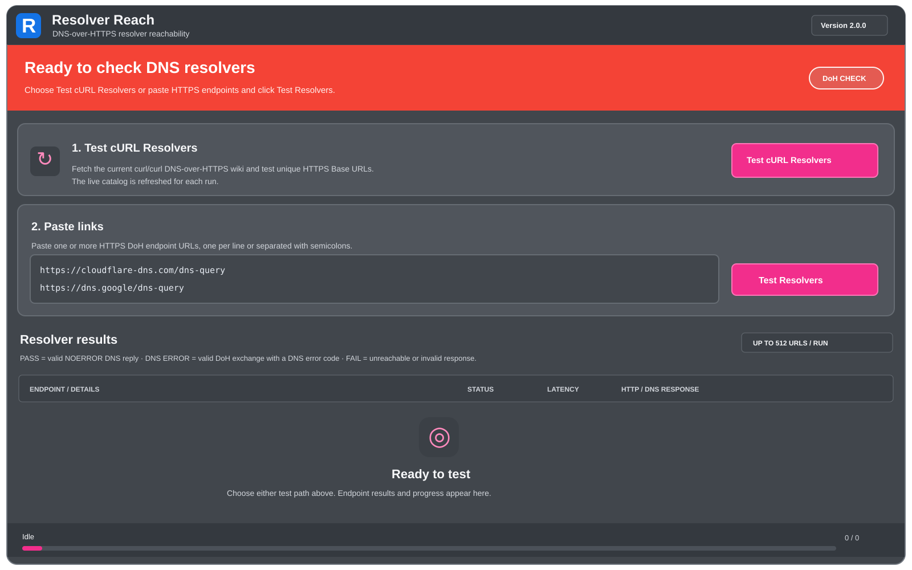

  

<h1 align="center">Resolver Reach 2.3.0</h1>

<strong>Single-window DNS-over-HTTPS tester for Windows x64 and native ARM64.</strong>

  <a href="https://github.com/PCUser2021/ResolverReach/releases/latest/download/ResolverReach-Setup-x64.exe"><strong>Download x64</strong></a>
  · <a href="https://github.com/PCUser2021/ResolverReach/releases/latest/download/ResolverReach-Setup-arm64.exe"><strong>Download ARM64</strong></a>

Resolver Reach checks whether DoH endpoints complete a valid DNS exchange. Test the live cURL catalog or paste your own HTTPS resolver URLs. Results and progress stay in the main window, and diagnostic logs can be exported to a ZIP.

  

*This is an illustrative UI design preview, not a screenshot captured from a running application.*

## Highlights
- Validate RFC 8484 DNS responses rather than HTTPS reachability alone.
- Distinguish valid DNS errors from transport failures and invalid DoH replies.
- Longer timeout tolerance, bounded retries, and HTTP/1.1 fallback for detected HTTP/2 protocol errors.
- Save Logs exports the current app session's activity and endpoint-result history to a user-selected ZIP file.
- Separate self-contained `win-x64` and native `win-arm64` installers.
- Original icon family: dark titanium/glass geometry with spectral cyan/blue/violet accents.

## Downloads

Published release: [Resolver Reach v2.3.0](https://github.com/PCUser2021/ResolverReach/releases/tag/v2.3.0). The v2.3.0 CI pipeline is configured to build and package both architecture installers before publishing them. Verify the workflow and Release assets before treating the new version as shipped.
- [Latest x64 installer](https://github.com/PCUser2021/ResolverReach/releases/latest/download/ResolverReach-Setup-x64.exe)
- [Latest native ARM64 installer](https://github.com/PCUser2021/ResolverReach/releases/latest/download/ResolverReach-Setup-arm64.exe)
- [All releases](https://github.com/PCUser2021/ResolverReach/releases)

## License
Original project code, documentation and project-authored assets are MIT licensed. Use, modify, and redistribute for any purpose subject to preserving the license/copyright notice. Third-party dependencies retain their own licenses.

## Updated build toolchain (2026-10-23)

- .NET SDK 10.0.402
- Avalonia 12.1.4; FluentAvaloniaUI 3.1.0
- ReactiveUI.Reactive 24.2.0; ReactiveUI.Avalonia.Reactive 12.1.6
- DynamicData 9.5.0
- GitHub Actions: checkout v7.0.1, setup-dotnet v6.0.0, upload-artifact v7.0.2, download-artifact v8.0.2, action-gh-release v3.0.3
- Inno Setup 7.1.0
